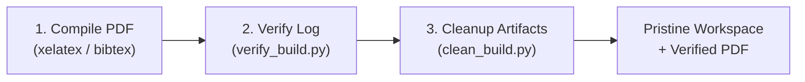

# LaTeX Post-Compilation Build File Cleanup Skill

This skill enforces strict workspace hygiene and automated cleanup of all intermediate and auxiliary build artifacts generated during LaTeX/XeLaTeX PDF compilations across the doctoral dissertation repository (`thesis_full_toc_persian_v3.tex`).

---

## 1. Core Rule & Invariant

> [!IMPORTANT]
> **Mandatory Post-Compilation Cleanup Invariant**:
> Immediately after compiling any LaTeX document to PDF and verifying the build log, the AI agent **MUST ALWAYS clean up all intermediate build files**. No compilation turn is considered complete until all auxiliary artifacts (`.aux`, `.log`, `.out`, `.toc`, `.lof`, `.lot`, `.bbl`, `.blg`, `.idx`, `.ilg`, `.ind`, `.synctex.gz`, `.xdv`) have been purged from the repository.

---

## 2. Rationale & Benefits

1. **Prevention of Stale Auxiliary Caching**:
   Recompiling with stale `.aux`, `.toc`, or `.out` files can mask broken cross-references, persist deleted labels, or produce ghost citations that do not exist in the source code.
2. **Git Repository Hygiene & 100MB Boundary Defense**:
   Intermediate files like `.xdv` (XeTeX DVI) frequently exceed several megabytes (e.g., $2.5\,\text{MB}+$ per run). Purging them prevents accidental staging and keeps `git status` clean and legible.
3. **Pristine Development Environment**:
   A clean workspace ensures that directory listings, IDE file pickers, and automated regex scanners operate exclusively on canonical source files (`.tex`, `.bib`, `.cls`, `.sty`, images).
4. **Deterministic Reproducibility**:
   Guaranteeing a clean state ensures that every compilation is an authentic, deterministic end-to-end build from clean sources.

---

## 3. Standard Compilation & Cleanup Workflow

Whenever a LaTeX compilation is performed, the agent **MUST ALWAYS use `compile_thesis.ps1`**, which automates this exact three-stage lifecycle:



### Stage 1: Compilation
Execute XeLaTeX (and BibTeX if citations changed):
```powershell
xelatex -interaction=nonstopmode thesis_full_toc_persian_v3.tex
bibtex thesis_full_toc_persian_v3
xelatex -interaction=nonstopmode thesis_full_toc_persian_v3.tex
```

### Stage 2: Zero-Defect Log Verification
Verify the compilation log before purging it:
```powershell
python .agents/skills/thesis-latex-typesetting/scripts/verify_build.py thesis_full_toc_persian_v3.log
```

### Stage 3: Mandatory Build File Cleanup
Purge all intermediate artifacts while preserving the compiled PDF and all source files:
```powershell
python .agents/skills/thesis-build-cleanup/scripts/clean_build.py
```

---

## 4. Cleanup Tooling & Command Reference

The cleanup script is located at `.agents/skills/thesis-build-cleanup/scripts/clean_build.py`.

### Standard Cleanup (Preserves `.pdf` and source files):
```powershell
python .agents/skills/thesis-build-cleanup/scripts/clean_build.py
```

### Dry-Run Mode (Preview files to be deleted):
```powershell
python .agents/skills/thesis-build-cleanup/scripts/clean_build.py --dry-run
```

### Deep Clean (Includes removing generated `.pdf` files):
```powershell
python .agents/skills/thesis-build-cleanup/scripts/clean_build.py --include-pdf
```

---

## 5. File Safety Invariants

The cleanup utility enforces strict safety guards:
- **Targeted Extensions**: `.aux`, `.log`, `.out`, `.toc`, `.lof`, `.lot`, `.fls`, `.fdb_latexmk`, `.synctex.gz`, `.bbl`, `.blg`, `.bcf`, `.run.xml`, `.idx`, `.ilg`, `.ind`, `.nav`, `.snm`, `.vrb`, `.xdv`, `.dvi`, `.ps`, `texput.log`.
- **Protected Files (NEVER Deleted)**:
  - LaTeX sources: `*.tex`, `commands.tex`
  - BibTeX databases: `References.bib`, `MyReferences.bib`, `*.bst`
  - Document classes and styles: `TMU-Thesis.cls`, `*.sty`
  - Figure assets: `figures/*`, `*.png`, `*.jpg`, `*.pdf` inside `figures/`
  - Agent instructions and skills: `AGENTS.md`, `.agents/**`

